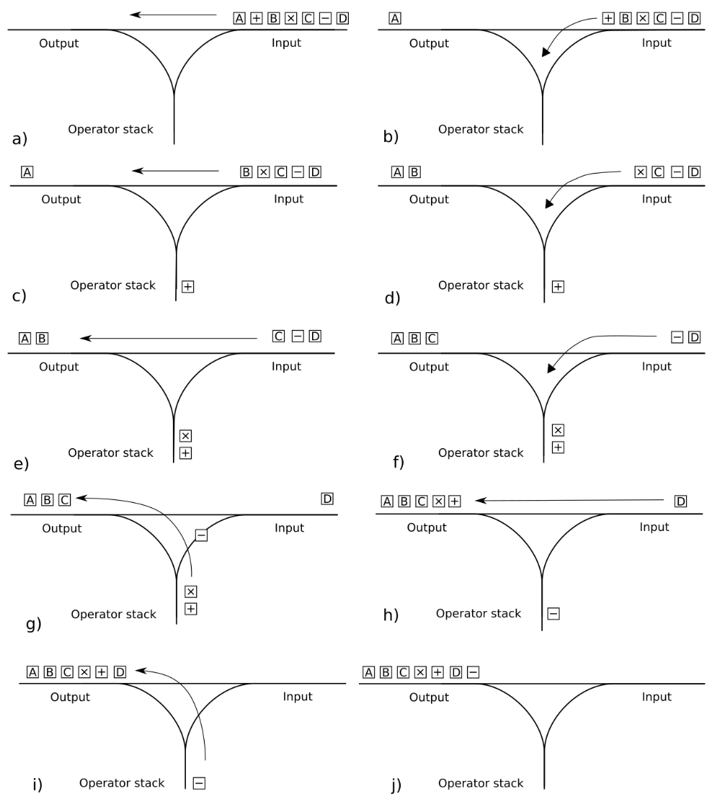

# Стек

## 1. Основни свойства

Стекът е линейна структура от данни, която следва принципа LIFO (*last-in, first-out*).

Ключови характеристики:

- **Единствена точка на достъп:** Всички операции (`push`, `pop`, `top`) се извършват само през върха на стека.
- **Липса на итератори:** В класическия си вид стекът не позволява произволен достъп или обхождане. Ако извлечем елементите, за да ги прочетем, това ще разруши текущата структура.
- **Сложност:** Операциите за добавяне, премахване и преглед на върха се изпълняват за константно време $\mathcal{O}(1)$.

## 2. Валидация на скоби

Едно от най-честите приложения на стека е проверката за синтактична коректност на скоби в изрази.

### 2.1. Наивен подход

Ако изразът съдържа само един тип ограждащи символи, можем да използваме целочислена променлива, която следи баланса между отварящите и затварящите скоби.

```cpp
bool validate(const char* expr) {
    int count = 0;

    while (*expr) {
        if (*expr == '(') ++count;
        else if (*expr == ')') --count;

        // Затваряме скоба, която не е била отворена
        if (count < 0) return false;

        ++expr;
    }

    // Ако броячът е 0, всички скоби са правилно затворени
    return count == 0;
}
```

### 2.2. Множество броячи и техните ограничения

При наличие на няколко вида ограждащи символи (`()`, `[]`, `{}`), независимите броячи губят способността си да проследяват реда на вложеност.

Например изразът `([)]` съдържа коректен брой отварящи и затварящи скоби от съответните типове, но е синтактично невалиден, тъй като последователността им е нарушена. Въпреки това броячите ще отчетат правилни крайни стойности.

```cpp
bool validate(const char* expr) {
    int count1 = 0, count2 = 0, count3 = 0;

    while (*expr) {
        if (*expr == '(') ++count1;
        else if (*expr == ')') --count1;
        else if (*expr == '[') ++count2;
        else if (*expr == ']') --count2;
        else if (*expr == '{') ++count3;
        else if (*expr == '}') --count3;

        if (count1 < 0 || count2 < 0 || count3 < 0) return false;

        ++expr;
    }

    return count1 == 0 && count2 == 0 && count3 == 0;
}
```

### 2.3. Корeктно решение чрез стек

Необходимо е да спазваме правилото, че **последно отворената скоба трябва да се затвори първа**. Това съвпада с LIFO поведението на стека.

Принцип на действие:

- **Отваряща скоба:** Записваме я в стека (`push`).
- **Затваряща скоба:** Проверяваме дали стекът е празен. Ако не е, сравняваме скобата от върха (`top`) с настоящата. Ако си съответстват, я премахваме (`pop`).

```cpp
bool is_closing_bracket(char ch) {
    return ch == ')' || ch == ']' || ch == '}';
}

bool is_opening_bracket(char ch) {
    return ch == '(' || ch == '[' || ch == '{';
}

bool match(char lhs, char rhs) {
    if (lhs == '(') return rhs == ')';
    else if (lhs == '[') return rhs == ']';
    else if (lhs == '{') return rhs == '}';
    else return false;
}

bool validate(const char* expr) {
    std::stack<char> st;

    while (*expr) {
        if (is_closing_bracket(*expr)) {
            if (st.empty()) return false;

            if (!match(st.top(), *expr)) return false;

            st.pop();
        }
        else if (is_opening_bracket(*expr)) {
            st.push(*expr);
        }

        ++expr;
    }

    // Ако е останало нещо отворено, значи изразът е грешен
    return st.empty();
}
```

## 3. Контекстно акумулиране във вложени изрази

Стекът може да съхранява текущото състояние (контекст) при обработка на вложени структури.

Разглеждаме израза:

```
(3 + (5 + 2))
```

Вътрешните скоби дефинират отделно подниво, което трябва да се изчисли самостоятелно, преди резултатът му да се върне към "родителския" израз. Следователно не можем веднага да сметнем всичко от ляво надясно.

Това ни води до следната идея:

- Всеки елемент на стека пази текущо натрупаната сума за съответното ниво на вложеност.
- При срещане на `(` създаваме нов контекст (добавяме `0` в стека).
- При срещане на `)` завършваме текущия контекст, извличаме стойността му и я прибавяме към предходното (родителско) ниво.

```cpp
int evaluate_sum(const char* expr) {
    std::stack<int> st;

    // Начално (най-външно) ниво
    st.push(0);

    while (*expr) {
        if (*expr == '(') {
            // Отваряме ново ниво на вложеност със собствена сума
            st.push(0);
        }
        else if (*expr == ')') {
            // Извличаме резултата от текущото ниво
            int current = st.top();
            st.pop();

            // Прибавяме го към предходното (родителско) ниво
            st.top() += current;
        }
        else if (std::isdigit(static_cast<unsigned char>(*expr))) {
            int num = 0;

            while (*expr && std::isdigit(static_cast<unsigned char>(*expr))) {
                num = num * 10 + (*expr - '0');

                ++expr;
            }

            st.top() += num;
        }

        ++expr;
    }

    return st.top();
}
```

Проследяване на състоянието за `(3 + (5 + 2))`:

| Обработен символ | Стек | Действие |
| --- | --- | --- |
| Начало | `[0]` | Създаваме външното ниво. |
| `(` | `[0, 0]` | Започваме ново ниво. |
| `3` | `[0, 3]` | Натрупваме 3. |
| `+` | `[0, 3]` | Игнорираме оператора. |
| `(` | `[0, 3, 0]` | Започваме вътрешно ниво. |
| `5` | `[0, 3, 5]` | Натрупваме 5. |
| `+` | `[0, 3, 5]` | Игнорираме оператора. |
| `2` | `[0, 3, 7]` | Натрупваме 2. |
| `)` | `[0, 10]` | Прехвърляме 7 към родителското ниво. |
| `)` | `[10]` | Прехвърляме 10 към външното ниво. |

## 4. Постфиксна нотация

Досега използвахме инфиксен запис, при който операторът се разполага между двата операнда, върху които действа:

```
(3 + 5) * 7
```

За да оценим този израз, трябва да съобразим скобите, приоритета на операциите и асоциативността им (напр. умножението се извършва преди събирането).

Друг начин за запис е:

```
3 5 + 7 *
```

Това представяне се нарича постфиксна нотация (*reverse Polish notation*). При него операторът се записва след операндите, върху които действа.

| Инфиксен запис | Постфиксен запис |
| --- | --- |
| `3 + 5` | `3 5 +` |
| `(8 - 2) / 3` | `8 2 - 3 /` |
| `(3 + 5) * 7` | `3 5 + 7 *` |
| `3 + 5 * 7` | `3 5 7 * +` |

Да забележим разликата между последните два израза: в първия първо се извършва събирането, а във втория - умножението. Постфиксният запис прави този ред явен.

Основното предимство е, че не е необходимо да пазим приоритета на операциите по време на изчислението. Когато срещнем оператор, операндите, върху които той действа, вече са налични в стека.

### 4.1. Алгоритъм за оценяване на постфиксен израз

Алгоритъмът за пресмятане на постфиксен израз е изключително елегантен и работи за линейно време:

- Четем израза от ляво надясно.
- Ако срещнем число (операнд), добавяме го в стека чрез `push()`.
- Ако срещнем бинарен оператор, извличаме два операнда от стека. Прилагаме операцията върху тях и добавяме получения резултат обратно.
- След обработката на целия израз крайният резултат трябва да е единственото останало число в стека.

При срещане на оператор първо извличаме десния аргумент и след това левия. Това е следствие от принципа LIFO - последният добавен операнд се извлича първи.

Например при `8 3 -` стекът съдържа първо `8` и след това `3`. Когато срещнем `-`, извличаме `3`, после `8`, но изчисляваме:

```
8 - 3 = 5
```

Ако разменим операндите, ще получим грешен резултат.

### 4.2. Реализация на C++

```cpp
int apply_binary_op(const std::string& op, int lhs, int rhs) {
    if (op == "*") return lhs * rhs;
    else if (op == "+") return lhs + rhs;
    else if (op == "-") return lhs - rhs;
    else if (op == "/") {
        if (rhs == 0) {
            throw std::runtime_error("Division by zero.");
        }

        return lhs / rhs;
    }

    throw std::runtime_error("Unexpected binary operator.");
}

int apply_unary_op(const std::string& op, int operand) {
    if (op == "+") return operand;
    else if (op == "-") return -operand;

    throw std::runtime_error("Unexpected unary operator.");
}

int evaluate_rpn(const std::vector<Token>& tokens) {
    // Стек за операндите и междинните резултати
    std::stack<int> st;

    for (const Token& token : tokens) {
        if (token.type == Token::Type::NUM) {
            st.push(std::stoi(token.value));
        }
        else if (token.type == Token::Type::OP) {
            if (token.unary) {
                if (st.empty()) {
                    throw std::runtime_error("Invalid RPN expression: not enough operands.");
                }

                int operand = st.top();
                st.pop();

                // Прилагаме унарната операция и връщамe резултата обратно в стека
                st.push(apply_unary_op(token.value, operand));
            }
            else {
                if (st.size() < 2) {
                    throw std::runtime_error("Invalid RPN expression: not enough operands.");
                }

                int rhs = st.top();
                st.pop();

                int lhs = st.top();
                st.pop();

                // Прилагаме бинарната операция и връщамe резултата обратно в стека
                st.push(apply_binary_op(token.value, lhs, rhs));
            }
        }
        else {
            throw std::runtime_error("Unexpected token type during RPN evaluation.");
        }
    }

    // В края на обхождането, валидният RPN израз трябва да е оставил
    // точно един елемент в стека
    if (st.size() != 1) {
        throw std::runtime_error("Invalid RPN expression: excess operands.");
    }

    return st.top();
}
```

## 5. Преобразуване от инфиксен към постфиксен запис

Алгоритъмът **Shunting Yard** (създаден от Едсхер Дейкстра) преобразува инфиксен израз в постфиксен (RPN).



### 5.1. Основни правила

Алгоритъмът работи с две основни структури - стек за операторите, който временно ги задържа, и изход (или низ) за готовия постфиксен израз.

Докато обхождаме инфиксния запис от ляво надясно, всеки символ попада в една от следните категории:

- **Операнд:** Директно се извежда на изхода.
- **Отваряща скоба:** Добавя се в стека с оператори.
- **Затваряща скоба:** Извличат се оператори от стека и се извеждат на изхода, докато се достигне `(`. Отварящата скоба се премахва от стека, без да се извежда.
- **Оператор (`op1`):** Докато на върха на стека има оператор (`op2`) с по-висок или равен приоритет (при лява асоциативност), `op2` се извлича от стека и се извежда на изхода. Накрая `op1` се добавя в стека.

В края на израза всички останали в стека оператори се извличат последователно и се извеждат на изхода.

### 5.2. Реализация на C++

```cpp
std::vector<Token> infix_to_rpn(const std::vector<Token>& tokens) {
    // Стек за операторите и скобите на изчакване
    std::stack<Token> operators;

    // Изходен вектор за постфиксния запис
    std::vector<Token> output;

    // Обхождаме всички токени от инфиксния израз от ляво надясно
    for (const Token& token : tokens) {
        if (token.type == Token::Type::NUM) {
            output.push_back(token);
        }
        else if (token.type == Token::Type::OP) {
            while (!operators.empty() && operators.top().type != Token::Type::PAREN_L) {
                // Сравняваме приоритетите и асоциативността
                if ((!token.rightAssociative && token.precedence <= operators.top().precedence) ||
                    (token.rightAssociative && token.precedence < operators.top().precedence)) {
                    output.push_back(operators.top());

                    operators.pop();

                    continue;
                }

                break;
            }

            // Слагаме новия оператор в стека
            operators.push(token);
        }
        else if (token.type == Token::Type::PAREN_L) {
            operators.push(token);
        }
        else if (token.type == Token::Type::PAREN_R) {
            // Прехвърляме операторите към изхода, докато стигнем отваряща скоба
            while (!operators.empty() && operators.top().type != Token::Type::PAREN_L) {
                output.push_back(operators.top());

                operators.pop();
            }

            // Ако стекът се изпразни, без да сме намерили '(',
            // значи скобите са объркани
            if (operators.empty()) {
                throw std::runtime_error("Mismatched parentheses.");
            }

            // Премахваме '(' от стека
            operators.pop();
        }
        else {
            throw std::runtime_error("Unexpected token.");
        }
    }

    // В края на израза изпразваме останалите оператори от стека към изхода
    while (!operators.empty()) {
        // Ако намерим отваряща скоба, значи има несъответствие
        if (operators.top().type == Token::Type::PAREN_L) {
            throw std::runtime_error("Mismatched parentheses.");
        }

        output.push_back(operators.top());

        operators.pop();
    }

    return output;
}
```